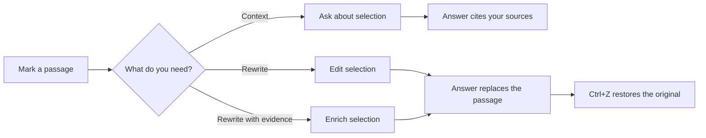

<p align="center">
  
</p>

# Scico — Talk to your Library!

Scico is a writing desk for researchers and students. Keep your sources in one
place, ask questions about them, and let the co-writer turn an answer into a
revision of the exact passage you marked — without leaving your draft.

**Designed for students and researchers.**  
Start with a folder, add your PDFs, and write. With Ollama, the whole stack
runs on your own machine; no account and no cloud upload.

- **Ask your own literature.** Index a corpus once, then ask questions and get
  answers grounded in the papers you chose, with sources attached.
- **Revise in place.** Mark a paragraph and ask for a rewrite. The chat agent
  replaces just that passage, as one undo step.
- **Search while you revise.** *Enrich selection* also searches the literature
  about the marked passage, so a rewrite can bring in the evidence you meant.
- **References that come along.** Keep your `.bib`, insert `@key` citations
  from the library, and let the chat agent resolve mentions into the right paper.
- **Never lose work.** A crash-safe journal restores every tab, unsaved
  sentence, caret, and pane layout — even after a crash or a forced shutdown.
- **Write, don't typeset.** Markdown and Quarto with inline images, tables,
  and a live preview. Use Quarto or Pandoc when it is time to make the PDF.
- **Local or hosted.** Ollama or a local llama.cpp server by default;
  DeepSeek & Co when you want a larger model. Choose your favorite provider
  and create a profile.
- **One workspace, one folder.** Paper, sources, bibliography, index, and
  sessions live together, so a project is easy to back up, share, version with
  Git, or archive.

> Scico is the writing and retrieval front end. The RAG engine underneath is
> the open-source [Ragrig](https://crates.io/crates/ragrig) library. If you
> want to build your own interface on it, start there.

---

## Quick Start

### You need three things

1. **Rust** — [rustup.rs](https://rustup.rs)
2. An **LLM provider**: 
  a. **Ollama** — [ollama.com/download](https://ollama.com/download) is required for retrieval,  and also is the default provider for the chat agent. It runs locally on your machine. Using local LLMs as chat agents is a quite limited experience, unless you demand over a GPU with 24+ GB VRAM. Scico can also pull and run the official Ollama container from *Settings → External services*.
  b. **llama.cpp** — Optional: run `llama-server -m model.gguf --port 8080` and select **llama.cpp** in *Settings → RAG → Chat*. Set the server URL there (default `http://localhost:8080/v1`) or point `LLAMACPP_API_BASE_URL` at it. *Settings → External services* can also run the official llama.cpp container with a Hugging Face model or a local `.gguf` file.
  c. **Frontier model** — Optional, but recommended: You can choose between a growing number of paid cloud providers for the chat agent, such as OpenAI, Deepseek, Claude and OpenRouter.
3. **A chat model and an embedding model.** For example:

```bash
ollama pull nomic-embed-text    # retrieval
ollama pull qwen2.5:1.5b        # optional: memory and query rewriting
ollama pull qwen3.5:9b          # chat agent
```

Run `ollama serve` if the desktop app is not already doing it for you.

### Get Scico

Install the binary from crates.io:

```bash
cargo install scico
scico
```

Or build it from a checkout:

```bash
git clone https://github.com/schmettow/scico
cd scico
cargo run
```

On Linux, the window toolkit needs two system libraries:

```bash
sudo apt install libxkbcommon-dev libxkbcommon-x11-dev
```

### Your first five minutes

1. **New workspace** (`Ctrl+Shift+N`) — pick an empty folder. Scico creates a
   place for the paper, your sources (`corpus/`), a bibliography, and the
   project index, then opens `Untitled-1.md`.
2. **Import PDFs** in the Library section of the Workspace panel. Scico copies
   them into the workspace's `corpus/`, reads their metadata, merges them into
   your `.bib`, and indexes them. Originals are left where they are.
3. **Write** in the left pane. The right pane previews Markdown, tables, and
   images. Drag the divider if you want more room.
4. **Ask Chat** a question such as *“What do these papers report about
   response times?”* Answers stream into the transcript and name the documents
   they used.
5. **Mark a sentence**, press **Edit selection** (`Ctrl+Shift+D`), and type an
   instruction: *“make this more precise and add a citation.”* Press
   `Ctrl+Enter`. The answer replaces only the marked passage; `Ctrl+Z` puts the
   original back.

> No literature yet? The chat agent still works as a plain chat partner. Add papers
> whenever you are ready; the next question will use them.

---

## The roundtrip: from question to revision

Most AI editors give you an answer in a chat bubble, and you copy it across.
Scico is built around the other direction:



- **Ask about selection** (`Ctrl+Shift+P`) attaches the passage to your next
  question. Mark several passages from one or more tabs; each gets a chip above
  the composer.
- **Edit selection** (`Ctrl+Shift+D`) treats the next prompt as an instruction.
  The answer comes back as a replacement for that passage, written into the
  document as a single undo step. While the chat agent writes, the passage stays marked
  and the document is read-only, so you cannot change it by accident.
- **Enrich selection** (`Ctrl+Shift+R`) does the same, but the marked passage
  also becomes the literature search. Use it when the rewrite should be
  grounded in what the field says about *this* claim, not just in your
  instruction.

If you edit the passage while the chat agent is still writing, the write is refused
rather than applied to the wrong text. The chat agent offers the answer as **Insert**
instead, so nothing is lost.

---

## Your library and your references

- **Fast Find** filters by key, author, year, title, or venue. The **X**
  clears the filter.
- **Click a reference** to insert its `@key` at the caret. Select several rows
  with **+** to insert a citation group such as `[@Kano2025, @Mila2023]`,
  attach the PDFs to your next question, or copy keys and file paths.
- The **pencil** action opens the workspace bibliography at that entry. Save
  or close the `.bib` file and the Library reloads the changed metadata. The
  Library's **BibTeX** button is a toggle: it opens the same file directly and
  clicking it again saves and closes the tab. While it is open, GROBID is
  blocked so a run cannot overwrite the tab; the button is disabled while
  GROBID is working.
- **Mention `@Kano2025`** in a question to attach that paper for one answer.
- **External services** (optional) cover GROBID, Ollama, and llama.cpp.
  *Settings → External services* has one group per service. Choose **Existing
  server** to use software you already run, **Existing container** to start and
  stop a hand-configured Docker container by name, or **Docker container** to
  pull and run the official image. With a managed or existing container,
  **Auto start** starts it whenever Scico opens; **Stop**, **Remove
  container**, **Cancel**, and pull/start progress are in the same group. Scico
  stops a managed container it started when the app quits; an **Existing
  container** is left running.
  - **GROBID** reads PDF headers and fills in authors, title, year, and DOI.
    The full image is the default (about 8 GB); the field is editable if you
    prefer the smaller CRF-only image. See the
    [GROBID Docker guide](https://grobid.readthedocs.io/en/latest/Grobid-docker/).
  - **Ollama** publishes `localhost:11434`. **Pull models** fetches the chat,
    embedding, and memory models configured in *Settings → RAG*; they stay in
    the `ragrig-ollama-models` volume when the managed container is removed.
    An **Existing container** such as a hand-built SYCL Ollama keeps its own
    devices and volumes; enter its Docker name in **Container name**.
  - **llama.cpp** publishes `localhost:8080`. The **Model** field accepts a
    Hugging Face repository (`owner/repo[:quant]`) or an absolute `.gguf` path;
    **Extra arguments** are passed to `llama-server`.
  - All three containers publish on loopback only. The managed Ollama and
    llama.cpp containers run on CPU; use an existing server when you need GPU
    acceleration.
- **Your bibliography stays yours.** Scico merges new records into the `.bib`
  file in the workspace; it does not lock you into a database.

---

## Workspaces

A Scico workspace is one ordinary directory:

```text
my-paper/
  Untitled-1.md        your paper (or paper.qmd)
  corpus/              PDFs and other source documents
  my-paper.bib         your bibliography
  Chat.md              optional project-specific writing prompt
  .ragrig/             index, chat sessions, profiles
  .scico/              workspace descriptor
```

- **New workspace** creates the whole set in an empty folder.
- **Open workspace** adopts an existing folder and adds only what is missing.
  A folder that already contains a paper and a `.bib` is adopted as it is.
- Entering a workspace closes tabs from other folders and opens the paper,
  with the paper in front. The bibliography opens on demand from the Library.
  Unsaved tabs are never discarded silently.
- **From a terminal**, `scico ~/my-paper` does the same: it opens that
  folder as a workspace, creating the missing pieces on the first visit.
- **The workspace is the working directory.** While a workspace is open,
  relative paths in file dialogs, Markdown links, and external tools resolve
  from its root; without one, the home directory is the fallback. **Open
  file**, **Open workspace**, **Import PDFs**, and every **Browse…** button
  start their dialog in the workspace or current folder. GROBID also records
  each PDF's `file` link relative to the workspace, so the project can move or
  be shared; a PDF on another drive is recorded absolutely. Settings show
  paths below your home as `~/…` and accept a typed `~`.
- **Nothing is hidden in a cloud account.** Copy the folder to a backup drive,
  a shared project space, or an archive when the paper is done.
- Settings are layered: your global preferences first, then the workspace's
  own `.ragrig/config.json`. The status-bar switches for **Chat memory** and
  **Hybrid retrieval** are saved with the workspace.
- **Profiles** live in `.ragrig/profiles`. In *Settings → Overview*, choosing
  a profile in the picker loads it; **New** asks for a name before snapshotting
  the current settings, and **Update Profile** saves to the selected profile.
- The left **Workspace** panel is the project's persistence and synchronization
  layer. It shows the project root and whether `.scico/workspace.toml` exists;
  the **Library** is one pipeline over it (corpus, index, and references), and
  further pipelines can join the same workspace shell.

---

## Keyboard shortcuts

| Keys | Action |
|---|---|
| `Ctrl+Enter` | Send the question |
| `Ctrl+Shift+P` | Ask about the marked selection |
| `Ctrl+Shift+D` | Edit the marked selection |
| `Ctrl+Shift+R` | Enrich and edit the marked selection |
| `Ctrl+Shift+L` | Show or hide the Workspace |
| `Ctrl+Shift+A` | Show or hide Chat |
| `Ctrl+Shift+E` | Show or hide the preview |
| `Ctrl+,` | Settings |
| `Ctrl+S` / `Ctrl+Shift+S` | Save / Save as |
| `Ctrl+O` | Open a document |
| `Ctrl+Shift+N` / `Ctrl+Shift+O` | New / Open workspace |
| `Ctrl+W` | Close the tab (asks before discarding changes) |
| `Ctrl+←` / `Ctrl+→` | Move by word (add `Shift` to select) |
| `PageUp` / `PageDown` | Move by a screen (add `Shift` to select) |
| `Ctrl` + wheel | Zoom the editor font |

On macOS, use `⌘` in place of `Ctrl`.

The first save of an `Untitled-x.md` placeholder asks for a real file name,
replaces the placeholder in the workspace, and makes the renamed paper the
workspace homepage. **Save as** is also available as a toolbar button next to
**Save**.

---

## Where your words go

- **Ollama** keeps the chat model and the index on your machine. Nothing is
  uploaded. A managed Ollama container also keeps its models in a local Docker
  volume.
- **llama.cpp** keeps the chat model on the machine running the container or
  `llama-server`. Point the provider at that server in Settings; a server
  started with `--api-key` reads its key from `LLAMACPP_API_KEY`.
- **DeepSeek** is a hosted option. Prompts and attached context are sent to
  the API; set `DEEPSEEK_API_KEY` in your environment. The key is read from the
  environment and never written to a profile or the workspace.
- The **Chat prompt** can be project-specific. The built-in prompt is
  compiled in; *Settings → RAG → Chat* lets you open it, export it as
  `Chat.md` into the workspace, or point to your own file. A workspace
  `Chat.md` is never overwritten.

---

## When something does not work

**“Ollama unreachable.”** Start `ollama serve`, check that port `11434` is
free, and confirm the model names in **Settings → RAG → Chat**. If you pulled a
model with an older Ollama, use its full name (`nomic-embed-text:latest`). A
managed Ollama container shows its state under **Settings → External services**;
use **Pull models** there to fetch the configured models.

**“llama.cpp connection refused.”** Check that `llama-server` is running and
that the URL in **Settings → RAG → Chat → llama.cpp URL** matches its port and
path (`/v1` is added automatically when omitted). If you use the managed
container, check the status under **Settings → External services**; a missing
model or a port conflict is reported there.

**“Docker is not running.”** Start Docker Desktop, or run `sudo systemctl start
docker` on Linux, then press **Refresh status** under **Settings → External
services**. If Docker runs but the app reports permission denied, add your user
to the `docker` group with `sudo usermod -aG docker $USER`, sign out and back in,
and restart Scico.

**Answers ignore my library.** Check that the corpus has been indexed
(**Workspace → Library → Index**), that **Hybrid retrieval** is on in the Chat
status bar, and that the question is specific enough to match a passage. With
hybrid retrieval off, the chat agent uses BM25 only; with no index at all it
answers as a plain chat model.

**GROBID is not running.** That is fine. PDFs are still indexed; only the
automatic author/title/year extraction is skipped. Use **Settings → External
services → Discover on localhost**, enter a URL, or press **Pull and start**
under **Docker container**. Docker Desktop (or the Docker daemon) must be
running. You can also fill in the `.bib` by hand and re-run **Import PDFs**
after a server is available. If the `.bib` tab is open, close it before
starting GROBID.

**I need a PDF with a journal template.** The chat agent writes Markdown and Quarto, not
a typeset page. Export or continue in Quarto/Pandoc, or paste the text into
your LaTeX template.

**Where is my work stored?** In the workspace folder you chose. The app also
keeps a crash-safe session journal in the platform config directory; it is what
restores unsaved text after a crash.

---

## Status

Scico is a working prototype. The editor, library, references, chat, and
the edit/enrich roundtrip are implemented; the internal API is still moving.
Bug reports and feature ideas are welcome at
[github.com/schmettow/scico](https://github.com/schmettow/scico).

If you want the architecture, editor backends, protocol details, and the test
matrix, read [DEVELOPER_NOTES.md](DEVELOPER_NOTES.md).

## License

MIT
