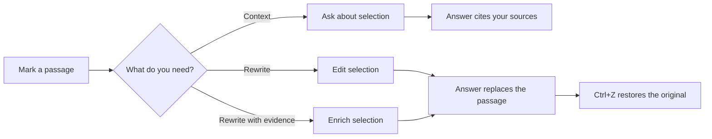

<p align="center">
  
</p>

# Scico — write your paper with your library

Scico is a writing desk for researchers and students. Keep your sources in one
place, ask questions about them, and let the co-writer turn an answer into a
revision of the exact passage you marked — without leaving your draft.

**Designed for students and researchers.**  
Start with a folder, add your PDFs, and write. With Ollama, the whole stack
runs on your own machine; no account and no cloud upload.

- **Ask your own literature.** Index a corpus once, then ask questions and get
  answers grounded in the papers you chose, with sources attached.
- **Revise in place.** Mark a paragraph and ask for a rewrite. The chat agent
  replaces just that passage, as one undo step.
- **Search while you revise.** *Enrich selection* also searches the literature
  about the marked passage, so a rewrite can bring in the evidence you meant.
- **References that come along.** Keep your `.bib`, insert `@key` citations
  from the library, and let the chat agent resolve mentions into the right paper.
- **Never lose work.** A crash-safe journal restores every tab, unsaved
  sentence, caret, and pane layout — even after a crash or a forced shutdown.
- **Write, don't typeset.** Markdown and Quarto with inline images, tables,
  and a live preview. Use Quarto or Pandoc when it is time to make the PDF.
- **Local or hosted.** Ollama by default; DeepSeek when you want a larger
  model. You choose per profile.
- **One workspace, one folder.** Paper, sources, bibliography, index, and
  sessions live together, so a project is easy to back up, share, version with
  Git, or archive.

> Scico is the writing and retrieval front end. The RAG engine underneath is
> the open-source [Ragrig](https://crates.io/crates/ragrig) library. If you
> want to build your own interface on it, start there.

---

## Quick Start

### You need three things

1. **Rust** — [rustup.rs](https://rustup.rs)
2. **Ollama** — [ollama.com/download](https://ollama.com/download)
3. **A chat model and an embedding model.** For example:

```bash
ollama pull qwen3.5:9b          # chat and writing
ollama pull nomic-embed-text    # retrieval
ollama pull qwen2.5:1.5b        # optional: memory and query rewriting
```

Run `ollama serve` if the desktop app is not already doing it for you.

### Get Scico

Scico is not on crates.io yet. Build it from a checkout:

```bash
git clone https://github.com/schmettow/scico
cd scico
cargo run
```

Or install the binary into `~/.cargo/bin`:

```bash
cargo install --path .
scico
```

On Linux, the window toolkit needs two system libraries:

```bash
sudo apt install libxkbcommon-dev libxkbcommon-x11-dev
```

### Your first five minutes

1. **New workspace** (`Ctrl+Shift+N`) — pick an empty folder. Scico creates a
   place for the paper, your sources (`corpus/`), a bibliography, and the
   project index, then opens `Untitled-1.md`.
2. **Add PDFs** in the Library section of the Workspace panel. Scico copies
   them into the corpus, reads their metadata, merges them into your `.bib`,
   and indexes them. Originals are left where they are.
3. **Write** in the left pane. The right pane previews Markdown, tables, and
   images. Drag the divider if you want more room.
4. **Ask Chat** a question such as *“What do these papers report about
   response times?”* Answers stream into the transcript and name the documents
   they used.
5. **Mark a sentence**, press **Edit selection** (`Ctrl+Shift+D`), and type an
   instruction: *“make this more precise and add a citation.”* Press
   `Ctrl+Enter`. The answer replaces only the marked passage; `Ctrl+Z` puts the
   original back.

> No literature yet? The chat agent still works as a plain chat partner. Add papers
> whenever you are ready; the next question will use them.

---

## The roundtrip: from question to revision

Most AI editors give you an answer in a chat bubble, and you copy it across.
Scico is built around the other direction:



- **Ask about selection** (`Ctrl+Shift+P`) attaches the passage to your next
  question. Mark several passages from one or more tabs; each gets a chip above
  the composer.
- **Edit selection** (`Ctrl+Shift+D`) treats the next prompt as an instruction.
  The answer comes back as a replacement for that passage, written into the
  document as a single undo step. While the chat agent writes, the passage stays marked
  and the document is read-only, so you cannot change it by accident.
- **Enrich selection** (`Ctrl+Shift+R`) does the same, but the marked passage
  also becomes the literature search. Use it when the rewrite should be
  grounded in what the field says about *this* claim, not just in your
  instruction.

If you edit the passage while the chat agent is still writing, the write is refused
rather than applied to the wrong text. The chat agent offers the answer as **Insert**
instead, so nothing is lost.

---

## Your library and your references

- **Fast Find** filters by key, author, year, title, or venue. The **X**
  clears the filter.
- **Click a reference** to insert its `@key` at the caret. Select several rows
  with **+** to insert a citation group such as `[@Kano2025, @Mila2023]`,
  attach the PDFs to your next question, or copy keys and file paths.
- The **pencil** action opens the workspace bibliography at that entry. Save
  or close the `.bib` file and the Library reloads the changed metadata.
- **Mention `@Kano2025`** in a question to attach that paper for one answer.
- **GROBID** (optional) reads PDF headers and fills in authors, title, year,
  and DOI. Open **Settings → External services** to discover a server that is
  already running, enter its URL, or let Scico pull and run the official
  Docker image. The full image is the default (about 8 GB); the image field is
  editable if you prefer the smaller CRF-only image. Scico stops a container it
  started when the app quits. See the
  [GROBID Docker guide](https://grobid.readthedocs.io/en/latest/Grobid-docker/).
- **Your bibliography stays yours.** Scico merges new records into the `.bib`
  file in the workspace; it does not lock you into a database.

---

## Workspaces

A Scico workspace is one ordinary directory:

```text
my-paper/
  Untitled-1.md        your paper (or paper.qmd)
  corpus/              PDFs and other source documents
  my-paper.bib         your bibliography
  Chat.md              optional project-specific writing prompt
  .ragrig/             index, chat sessions, profiles
  .scico/              workspace descriptor
```

- **New workspace** creates the whole set in an empty folder.
- **Open workspace** adopts an existing folder and adds only what is missing.
  A folder that already contains a paper and a `.bib` is adopted as it is.
- Entering a workspace closes tabs from other folders and opens the paper and
  its bibliography, with the paper in front. Unsaved tabs are never discarded
  silently.
- **From a terminal**, `scico ~/my-paper` does the same: it opens that
  folder as a workspace, creating the missing pieces on the first visit.
- **Nothing is hidden in a cloud account.** Copy the folder to a backup drive,
  a shared project space, or an archive when the paper is done.
- Settings are layered: your global preferences first, then the workspace's
  own `.ragrig/config.json`. The status-bar switches for **Chat memory** and
  **Hybrid retrieval** are saved with the workspace.
- **Profiles** live in `.ragrig/profiles`. In *Settings → Overview*, choosing
  a profile in the picker loads it; **New** asks for a name before snapshotting
  the current settings, and **Update Profile** saves to the selected profile.
- The left **Workspace** panel is the project's persistence and synchronization
  layer. It shows the project root and whether `.scico/workspace.toml` exists;
  the **Library** is one pipeline over it (corpus, index, and references), and
  further pipelines can join the same workspace shell.

---

## Keyboard shortcuts

| Keys | Action |
|---|---|
| `Ctrl+Enter` | Send the question |
| `Ctrl+Shift+P` | Ask about the marked selection |
| `Ctrl+Shift+D` | Edit the marked selection |
| `Ctrl+Shift+R` | Enrich and edit the marked selection |
| `Ctrl+Shift+L` | Show or hide the Workspace |
| `Ctrl+Shift+A` | Show or hide Chat |
| `Ctrl+Shift+E` | Show or hide the preview |
| `Ctrl+,` | Settings |
| `Ctrl+S` / `Ctrl+Shift+S` | Save / Save as |
| `Ctrl+O` | Open a document |
| `Ctrl+Shift+N` / `Ctrl+Shift+O` | New / Open workspace |
| `Ctrl+W` | Close the tab (asks before discarding changes) |
| `Ctrl+←` / `Ctrl+→` | Move by word (add `Shift` to select) |
| `PageUp` / `PageDown` | Move by a screen (add `Shift` to select) |
| `Ctrl` + wheel | Zoom the editor font |

On macOS, use `⌘` in place of `Ctrl`.

---

## Where your words go

- **Ollama** keeps the chat model and the index on your machine. Nothing is
  uploaded.
- **DeepSeek** is a hosted option. Prompts and attached context are sent to
  the API; set `DEEPSEEK_API_KEY` in your environment. The key is read from the
  environment and never written to a profile or the workspace.
- The **Chat prompt** can be project-specific. The built-in prompt is
  compiled in; *Settings → RAG → Chat* lets you open it, export it as
  `Chat.md` into the workspace, or point to your own file. A workspace
  `Chat.md` is never overwritten.

---

## When something does not work

**“Ollama unreachable.”** Start `ollama serve`, check that port `11434` is
free, and confirm the model names in **Settings → RAG → Chat**. If you pulled a
model with an older Ollama, use its full name (`nomic-embed-text:latest`).

**Answers ignore my library.** Check that the corpus has been indexed
(**Workspace → Library → Index**), that **Hybrid retrieval** is on in the Chat
status bar, and that the question is specific enough to match a passage. With
hybrid retrieval off, the chat agent uses BM25 only; with no index at all it
answers as a plain chat model.

**GROBID is not running.** That is fine. PDFs are still indexed; only the
automatic author/title/year extraction is skipped. Use **Settings → External
services → Discover on localhost**, enter a URL, or press **Pull and start**
under **Docker container**. Docker Desktop (or the Docker daemon) must be
running. You can also fill in the `.bib` by hand and re-run **Add PDFs**
after a server is available.

**I need a PDF with a journal template.** The chat agent writes Markdown and Quarto, not
a typeset page. Export or continue in Quarto/Pandoc, or paste the text into
your LaTeX template.

**Where is my work stored?** In the workspace folder you chose. The app also
keeps a crash-safe session journal in the platform config directory; it is what
restores unsaved text after a crash.

---

## Status

Scico is a working prototype. The editor, library, references, chat, and
the edit/enrich roundtrip are implemented; the internal API is still moving.
Bug reports and feature ideas are welcome at
[github.com/schmettow/scico](https://github.com/schmettow/scico).

If you want the architecture, editor backends, protocol details, and the test
matrix, read [DEVELOPER_NOTES.md](DEVELOPER_NOTES.md).

## License

MIT
